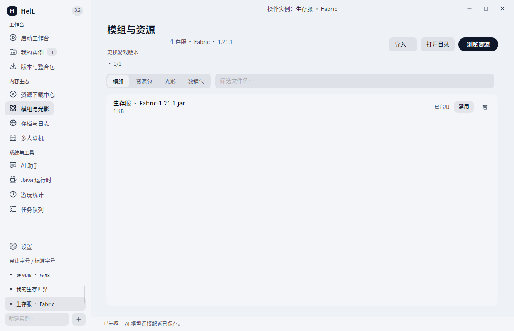
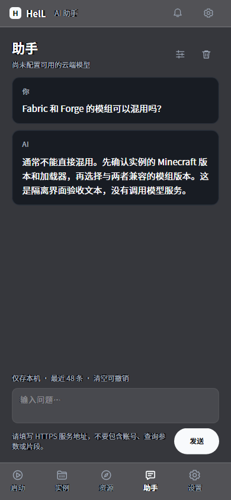
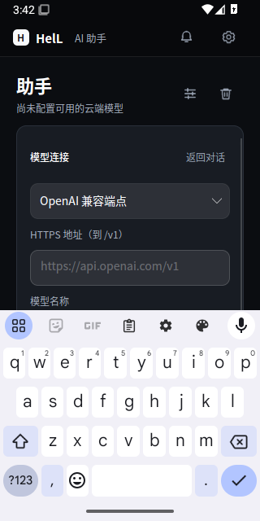
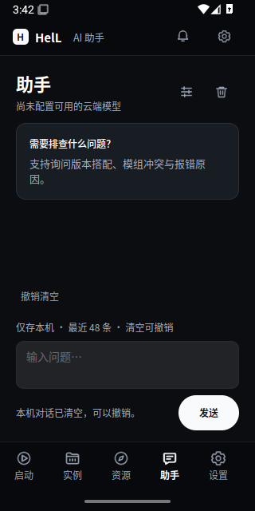
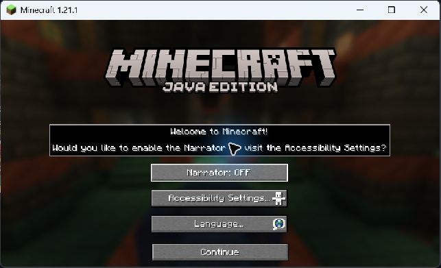

# 中文体验与实例上下文验收

本轮继续检查用户能否认清当前实例和版本、保存失败是否保持可信状态，以及手机返回键能否按预期结束编辑。不能仅凭中文文案和测试通过，宣称“中文 UX 极佳”。

1. **实例与版本内容**：原模组、存档和服务器管理读取实例根目录，完全隔离版本的资源无法显示。现在按所选版本和隔离设置读取，页面标明实例、版本并提供切换入口。切回实例保留本次会话选择的版本；主页数量与管理页一致。
2. **资源读写与撤销**：禁用、删除、备份和恢复使用捕获的目录。部分隔离模式使用预期的共享目录，拒绝指向其他位置的链接。已有非空版本目录按游戏实际行为保留。服务器撤销恢复原目录，但保持当前页面实例；原实例改名或目录消失时拒绝重建旧目录。非模组列表显示文件名，不再把绝对路径作为名称。
3. **设置与退出**：Desktop/Mobile 外观先提交配置再更新界面；失败保持原内存、版本号与主题。Desktop 未保存网络设置退出前提醒，拒绝退出后恢复正常任务调度。实例选择保存失败时侧栏恢复原选中项。
4. **Android AI 返回**：首个返回由系统收起键盘，随后返回关闭连接设置并留在对话，草稿保留且不自动再次弹出键盘。新增原生验收已在一次性 Android 模拟器通过，150% / 200% 系统字体、重启恢复也通过。模拟器安装了 TalkBack，但实际语音播报仍未验证。
5. **真实试玩安装启动**：隔离目录使用官方源下载 Minecraft 1.21.1，约 790 MB / 3890 个文件，完成校验后启动 Java 21。已观察真实首次欢迎页与试玩主菜单，进程最终正常退出（0）。这证明真实客户端可启动，不代表进入世界、完整玩家账号授权或所有加载器安装。

微软首次登录由用户明确选择稍后补验；本轮没有读取或复用真实账号凭据。Android 本机 `adb devices` 无设备且无模拟器；原生证据来自 PR CI 的一次性模拟器，本地 Mobile preview 只作为桌面宿主证据。

## 回归与证据

生成证据保留在未跟踪的 `TestResults/chinese-ux-20261123/`。`red/user-journey.json` 有 9 项失败，覆盖双实例的隔离目录和外观写失败；`selection-red/` 捕获侧栏与内存实例不一致。`mobile-red/` 复现 AI 返回误离开对话；`mobile-appearance-red/` 复现外观写失败改动可见状态。后续同一断言由失败转为通过，保留原断言。

`delivery/` 的 Desktop 旅程和 `smoke-delivery/` 的完整 Desktop smoke 均通过。旅程包含双实例/双版本、模组启停、服务器撤销、部分隔离共享导入、外观失败/重读及退出草稿检查。Mobile preview 的 320×720、390×844、844×390 三种尺寸均通过，最终平台事件调整后在 `mobile-delivery/` 重验 390×844 通过。服务测试 Desktop 29 通过 / 1 跳过，Mobile 69 通过。`game-profile/live-game.json`、`live-exit.json` 和 `minecraft-live.jpg` 记录真实试玩。

## 实例与版本

模组页标明当前实例与 Minecraft 版本，并提供“更换游戏版本”。切换实例后列表、操作目标与首页计数使用相同目录。下图来自提交 `d4827cb` 的 Linux CI 渲染，使用验收夹具，不是真实玩家资源。

## 保存失败

外观写入失败时保持原主题和透明度，显示“外观保存失败，已保留原设置。请检查数据目录后重试。”小窗口中，色调和通透度说明各占一行，避免被选项按钮挤住。本机 `settings-save-failed.png` 原始截图保留在测试目录；因宿主渲染文字重影，不作为视觉交付图。

## 手机对话与返回

连接设置返回对话后保留内容与输入草稿。图为桌面宿主的 Mobile preview，回答文本来自明确标注的离线布局回归，不代表真实模型调用，也不能替代 Android 键盘或 TalkBack 验收。

下图为 `d4827cb` 的原生 Android 模拟器截图：编辑地址时打开系统键盘；按返回收起键盘，再按一次回到对话，输入区重新可见。

原生证据见 [前端验收运行](https://github.com/addxiaoyi/HELCL/actions/runs/45207296844) 的 `frontend-android-45207296844` 产物：`ai-native-acceptance.json` 中键盘与返回均为 `true`，`talkbackSpeechVerified` 为 `false`；`acceptance.json` 记录字体倍率 1.5 与 2、实例和凭据跨进程恢复。此结果不等于物理设备或读屏语音验收。

## 真实游戏启动

使用官方源完成试玩安装后，真实 Minecraft 1.21.1 客户端显示首次欢迎页，最终正常退出。首次游戏语言仍为英文，不能把启动器中文界面等同于游戏自动中文化；也尚未验证进入试玩世界。

本轮保留现有图标、中文标题和有意义的状态提示。资源封面、模组详情、首次游戏语言配置及 TalkBack 真实播报仍是后续体验验收范围。
