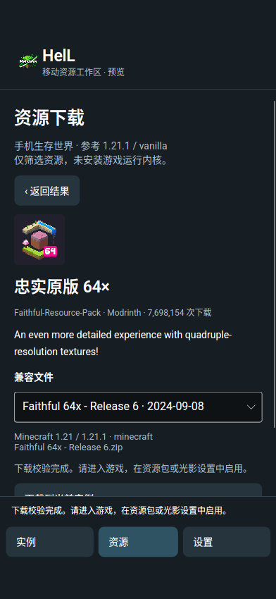
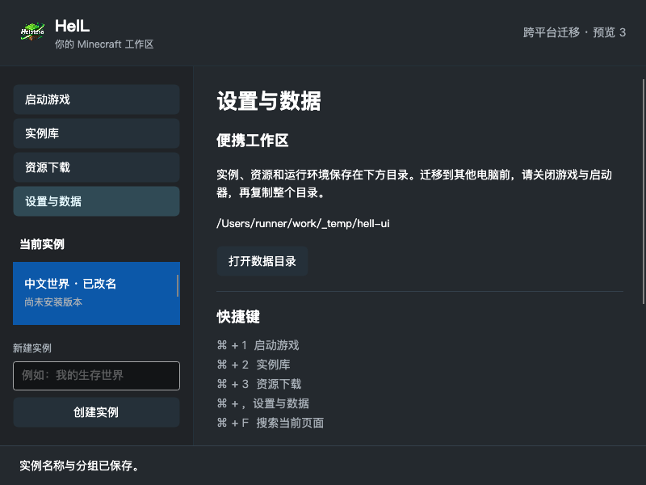

# Android、macOS 与跨平台预览交付

2026-11-11，代码提交 `6e070b53ec0e42dab450726b0effbcfe8513e91b`，分支 `codex/portable-native-20261111`。本轮独立执行，未使用子代理；未改写原工作区 `D:/qwq/qdq`，没有合并 main、创建正式 Release 或提交 SignPath 申请。

## 构建与运行结果

- [桌面最终 CI 42983236599](https://github.com/addxiaoyi/HELCL/actions/runs/42983236599)：Windows x64、Linux x64/ARM64、macOS Intel/Apple Silicon **全部成功**。每个平台通过 58 项 .NET 测试、9 项打包测试、解包后的两次启动与实例恢复、界面截图和系统凭据往返。
- [Android 最终 CI 42983236716](https://github.com/addxiaoyi/HELCL/actions/runs/42983236716)：签名 APK 构建、`apksigner` 验签、API 35 x86_64 模拟器安装、原生页面自检、真实网络资源下载和跨进程恢复 **全部成功**。
- Android `acceptance.json`：`platform=android-x64`、`androidVersion=15`、`nativeResourceDownload=true`、`nativeApkRestartAlive=true`、`nativeApkRestoredInstances=1`、`gameExecutionSupported=false`。画面实测约 393×851 DIP，实际系统截图为 1080×2340。
- Android 真实中文搜索“忠实”得到 `faithful-64x`，显示对应上游图标，下载版本 `BauEG3pq` 的文件 16,767,880 字节；SHA-512 与上游一致：`049569de400479d33bbc99acb79084b937d37da3e7a16edd8e248b135344eab48c1735bf664d697ce5f2ee15ea0b07f1dead634395a82862d9ab3b2bb8264589`。
- macOS `ui-smoke.json` 断言 `settings=true`、`macMenu=true`；涵盖启动页、实例库、资源页和设置页的 800/1060 DIP 截图，原生“工作区”菜单及 Command 快捷键已接入。菜单安装由自动化断言确认，未声称在实体 Mac 上手动点击过。

## 页面范围

桌面实例库支持紧凑列表/封面双视图、中文搜索、固定、分组、改名、自选封面和数据目录入口。资源页支持六类资源、双来源、真实图标/作者、中文映射与原文切换、兼容文件选择、取消与失败重试、同名文件保护和目标存档数据包安装。macOS 增加原生工作区菜单、⌘1/2/3、⌘逗号设置、⌘F 搜索，保留平台窗口按钮。

Android 使用独立触屏页面与底部导航，支持实例编辑、参考游戏版本/加载器、自选封面、ZIP 导出备份、资源搜索与下载、设置与数据说明。参考 Fabric/Forge/NeoForge/Quilt 只决定资源兼容性，不安装运行内核。所有下载资源依然使用上游校验值；系统应用目录先通过 Android `CanonicalPath` 解析，再执行原有路径安全检查，修复 `/data/user/0` 系统别名导致下载被阻止的问题。

## 安装与签名

Android APK 在 `android-preview-apk` 附件，包含 `HelL-3.2.0-preview.3-android.apk`、`SHA256SUMS` 和 `signature.txt`。使用可复用的预览证书，SHA-256 为 `FA:F0:DF:5A:64:5D:37:0E:05:5C:5D:04:6D:CC:03:23:A0:F1:41:D5:2B:6A:08:56:6C:24:D5:93:CF:68:60:7B`，公钥证书见 [android-preview-certificate.pem](android-preview-certificate.pem)。私钥保存在本机受限目录和 GitHub Secrets，不在源码或构建附件中。

最终 APK 已下载到本机重新核对：67,640,931 字节，SHA-256 为 `00f585e424b56bb4e75988ebcbfad1a6bd8e24fb1f4ecc14d3fcb817807ff760`，与 `SHA256SUMS` 一致；ZIP 内部完整性、ARM64/x86_64 原生库以及许可文件检查通过。CI 的 `apksigner` 报告确认 APK v2、v3 签名有效，证书摘要与上述公钥一致。

## 实际页面截图

Android 模拟器内的真实资源下载完成页面：

macOS Apple Silicon runner 的 800 DIP 设置页控件渲染：

桌面包在 `native-acceptance-*` 附件；小型报告和截图在 `native-evidence-*`。macOS 为 ad-hoc 签名，仍未公证，Gatekeeper 拒绝结果已保存。Windows 仍未正式签名。根 MIT 许可证已按维护者选择加入并保留上游 wfwwq 声明；SignPath 的上游签名条件和完整来源盘点仍未解决。详见 [许可证核实](license-provenance.md)、[Android 安装说明](android-preview.md) 与 [macOS 首次打开步骤](macos-desktop-acceptance.md)。

## 实测边界

Android APK 包含 ARM64 与 x86_64，当前原生运行证据来自 x86_64 模拟器，尚无 ARM64 真机触控/输入法/文件选择器验收；Android 尚不能运行 Minecraft Java 版，也未接入微软登录。备份可导出，应用内备份恢复仍待接入。模组必需依赖需另行准备，整合包只下载原文件。

没有真实 Mac，按维护者选择完成首次打开检查脚本与步骤；GitHub runner 的 `quarantinePresent=false`、`manualFirstOpenVerified=false` 不代表浏览器下载后的 Gatekeeper 交互已通过。资源下载验证不等于游戏内启用验证。真实微软账号和 CurseForge 完整联网安装流程未在本轮实测。

本机报告位于 `D:/UserCache/Temp/helcl-delivery-preview3`，前期桌面资源与布局证据见 [preview.3 工作区验收](portable-workspaces-preview3.md)。后续文档提交与上述经过测试的代码提交分开记录。
